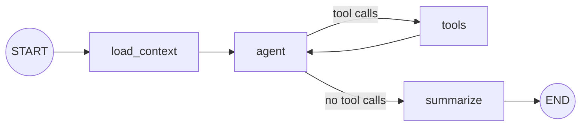

# The Planly agent

A LangGraph `StateGraph` with tools, running on a local Ollama model. It is a planner, not a chatbot: it reads the real state of your day, changes it through the same `TaskService` the UI uses, and every change it makes is undoable.

## Graph



| Node | What it does | LLM? |
|---|---|---|
| `load_context` | Reads today and tomorrow, Missed tasks, the last 15 Change sets and all Preferences from Postgres; renders them as compact text into `state.context`. | No |
| `agent` | Calls the chat model with `[system prompt + context] + messages`, tools bound. The system message is rebuilt every turn and never stored in the Thread, so the Thread holds only real conversation. | Yes |
| `tools` | LangGraph `ToolNode` running the tools below. | No |
| `summarize` | Collects the Change sets this run created (by `agent_run_id`) into `state.changes` for the UI's "Agent changed 3 things · Undo" card. | No |

The loop is capped (`recursion_limit = 24`, about 10 tool rounds).

## State

```python
class AgentState(TypedDict):
    messages: Annotated[list[AnyMessage], add_messages]  # persisted conversation
    now: str            # browser local time with UTC offset, e.g. "2026-10-30T10:05:00+05:30"
    run_id: str         # uuid of this run; tagged on every Change set the agent makes
    context: str        # rendered by load_context, rebuilt each run
    changes: list[dict] # Change sets made in this run (from summarize)
```

## Tools

All tools are thin wrappers over `TaskService(actor="agent", agent_run_id=run_id)`. Each call commits atomically as one Change set. Task ids are small integers so a 7B model can copy them reliably.

| Tool | Purpose |
|---|---|
| `list_tasks(start_date, end_date, status?)` | Tasks in a date range (inclusive). |
| `get_task(task_id)` | One Task with notes, Checklist items and Resources. |
| `create_task(title, type, date?, start?, duration_min?, priority?, notes?)` | Add a Task (for example, to split a big one). |
| `update_task(task_id, title?, type?, duration_min?, priority?, notes?, status?)` | Edit fields, including marking done/skipped. |
| `reschedule_task(task_id, date, start?)` | Move one Task. |
| `replan_day(date, pull_earlier?)` | Run the deterministic Scheduler for that day (below). |
| `find_resources(task_id, query?)` | Stored Resources; plus web results when `WEB_SEARCH_ENABLED=true`. |
| `save_resource(task_id, title, url?, kind?, note?)` | Attach a Resource. |
| `evaluate_progress(start_date, end_date)` | Done / todo / skipped / missed counts, by type, and completion rate. |
| `remember_preference(text)` | Store a Preference; it appears in every later run's context. |

There is no delete tool (FR-4.9).

## Scheduler (`agent/scheduler.py`)

A pure function, so the time arithmetic is done by tested code and not by the LLM (ADR-0001):

```
replan(day, tasks, missed, now, window=(08:00, 22:00), compact=False)
  cursor   = max(window.start, now rounded up to 5 min)   # if day is today; window.end if day is past
  keep     = meetings (never move)
             + flexible timed tasks still ahead of cursor that don't clash   # unless compact
  place    = flexible tasks whose time has passed, clashing tasks, then missed tasks
             (compact: every flexible timed task), ordered by priority then original start
  for task in place:
      earliest = cursor for missed/compact tasks, else max(cursor, its original start)   # clashes only push later
      slot     = first gap ≥ earliest of the task's length (default 30 min) not overlapping kept/placed tasks
      if slot ends ≤ window.end → place it there
      else → move it to day + 1 as Anytime
```

Anytime, completed and skipped Tasks are never moved. `replan_day(date, pull_earlier=true)` turns on `compact`, which the Agent uses when the user finished early and the rest of the day can move forward. The tool returns the moves it made, so the model can explain them. Tests: `tests/test_scheduler.py`.

## Triggers (`agent/graph.py`)

Every run starts with a message that is saved in the Thread:

| Trigger | Started by | First message (generated by code, not typed by the user) |
|---|---|---|
| `chat` | The user sending a message | The user's text. |
| `task_event` | UI, 4 s after the last tick or move | `[update] Completed #12 "DSA practice" at 10:05 — planned 09:30–11:00, finished 55 min early. Moved #15 "Gym" to 2026-10-31. Adjust the rest of today if useful; don't change anything if the plan still works.` |
| `day_review` | UI, on the first open of a day with Missed tasks | `[day review] 2 missed tasks: #7 …, #9 …. Today has 5 tasks. Re-plan the missed tasks sensibly, then tell me what you did.` |

Trigger messages are `HumanMessage(name="planly")`. The UI renders them as small grey chips, not as user bubbles.

## Modules

| Module | Interface |
|---|---|
| `agent/runtime.py` | `AgentRuntime.open(settings, sessionmaker, llm?)` → `stream(trigger, now, message?, change_set_ids?)`, `thread()`, `reachable()`, `busy`. The only thing the API touches. |
| `agent/graph.py` | `build_graph(llm, sessionmaker, settings, checkpointer)`, plus the plain-code context and trigger-message rendering. |
| `agent/tools.py` | `build_tools(sessionmaker, settings)` → the 10 tools. |
| `agent/scheduler.py` | `replan(...)`, pure. |

## Persistence

`AsyncPostgresSaver` (`langgraph-checkpoint-postgres`), with a single Thread `planly-main`. The conversation and the last state survive restarts. `GET /api/agent/thread` reads the Thread back for the UI.

## Streaming to the UI

`graph.astream(input, config, stream_mode=["messages", "updates"])` is mapped to SSE events:

| SSE event | Data |
|---|---|
| `message` | `{"role": "user" \| "event", "content": "..."}` — the run's first message, echoed so the UI can show trigger chips |
| `token` | `{"text": "..."}` — model text from the `agent` node |
| `tool_call` | `{"name": "...", "args": {...}}` |
| `tool_result` | `{"name": "...", "content": "..."}` (truncated) |
| `changes` | `[{"id": 41, "summary": "Moved #7 …", "undone": false}]` |
| `error` | `{"message": "Ollama is not reachable at …"}` |
| `done` | `{}` |

Only one run per Thread at a time. A second request while a run is active gets 409, and the UI queues triggers.

## Model choice

The default is `qwen2.5:7b`, the most reliable tool-caller at that size in Ollama. Change it with `OLLAMA_MODEL`. Anything with Ollama tool support works (`llama3.1:8b`, `qwen3:8b`, `mistral-nemo`). Temperature is 0.2. The context window is set to 8,192 tokens (`OLLAMA_NUM_CTX`): the system prompt, plan context and tool definitions alone are about 1,700 tokens, so Ollama's 4,096 default would start dropping the instructions once the conversation grows.

## Testing

`tests/test_agent.py` replaces the LLM with a scripted fake chat model that emits pre-written tool calls. The tests check the graph wiring, that tools change the database through `TaskService` with actor `agent`, that `summarize` reports the run's Change sets, and that a new graph instance on the same checkpointer still sees the Thread.
