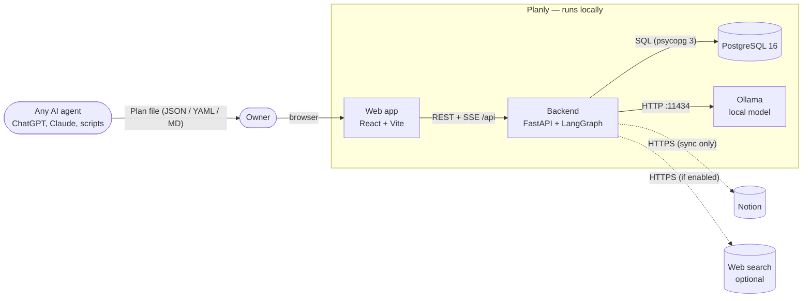
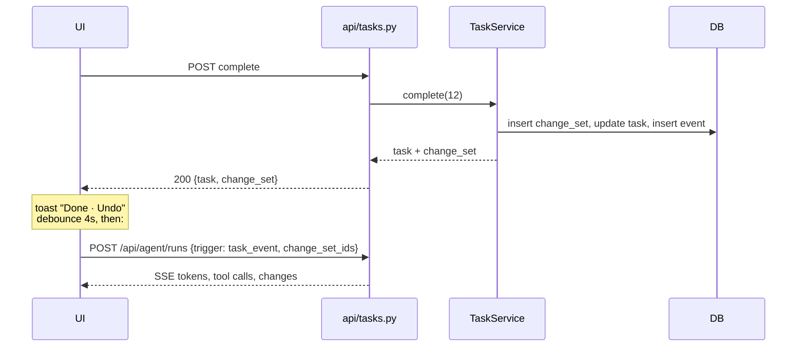

# Architecture

Planly is four processes on the user's machine. The browser talks only to the backend; the backend owns the database and is the only thing that talks to Ollama, Notion and the web.

## System context



## Backend modules

```mermaid
flowchart TB
  subgraph api[app/api — HTTP adapters]
    tasks_r[tasks.py]
    imports_r[imports.py]
    history_r[history.py]
    state_r[state.py]
    agent_r[agent.py — SSE]
  end

  subgraph core[core modules]
    svc["services/tasks.py<br/><b>TaskService</b><br/>the only writer"]
    imp["importers/<br/>parse → PlanDraft → persist"]
    subgraph agent[agent/]
      graph[graph.py<br/>StateGraph]
      tools[tools.py]
      sched[scheduler.py<br/>pure]
      ctx[context.py]
      trig[triggers.py]
      rt[runtime.py<br/>checkpointer + runs]
    end
  end

  models[models.py — SQLAlchemy]
  db[(PostgreSQL)]

  tasks_r --> svc
  history_r --> svc
  imports_r --> imp --> svc
  state_r --> imp
  agent_r --> rt --> graph
  graph --> ctx
  graph --> tools --> svc
  tools --> sched
  agent_r --> trig
  svc --> models --> db
  rt -- "AsyncPostgresSaver" --> db
```

### The one rule
**`TaskService` is the only code that changes Tasks, Checklist items, Resources and Preferences** ([ADR-0004](adr/0004-change-sets-and-single-writer.md)). Every public method:
1. opens a Change set (actor = `user` | `agent` | `import`),
2. snapshots the entity before, applies the change, snapshots after,
3. writes one Event per entity touched,
4. commits once.

This gives requirement #4 ("every time the state should be stored") for free: the database *is* the history. Undo is one generic operation over Events, not per-feature code.

### Request flows

**Tick a task** (`POST /api/tasks/12/complete`)


**Agent run** — see [AGENT.md](AGENT.md).

**Import** — `parse(file) → PlanDraft` (pure, per format) → `persist(draft)` (upsert by `(plan, external_id)`, one Change set, actor `import`).

## Frontend modules

```
frontend/src/
  app/            App shell, layout, providers, theme
  design/         tokens.css, materials, motion constants
  lib/            api client, SSE reader, dates
  features/
    timeline/     week strip, day timeline, task cards
    checklist/    grouped checklist, move popover, task sheet
    chat/         side panel, streaming messages, change summary
    import/       import sheet (drop zone, Notion sync, agent prompt)
    history/      history popover + undo toasts
```

Server state lives in TanStack Query; every mutation invalidates the `tasks` query, so Agent changes, imports and undos all re-render through the same path. Card movement uses `motion` layout animations keyed by task id.

## Deployment

`docker-compose.yml` runs `postgres`, `ollama`, `backend` (runs `alembic upgrade head` then `uvicorn`) and `frontend` (Vite build served by nginx, `/api` proxied to the backend). For development, run Postgres and Ollama however you like and use `make dev`.

## Decisions
- [ADR-0001](adr/0001-langgraph-agent.md) LangGraph tool-calling agent with a deterministic scheduler
- [ADR-0002](adr/0002-postgres-for-all-state.md) PostgreSQL for app state and agent checkpoints
- [ADR-0003](adr/0003-ollama-local-llm.md) Ollama as the only LLM runtime
- [ADR-0004](adr/0004-change-sets-and-single-writer.md) Change sets and a single writer
- [ADR-0005](adr/0005-integer-task-ids.md) Integer task ids
