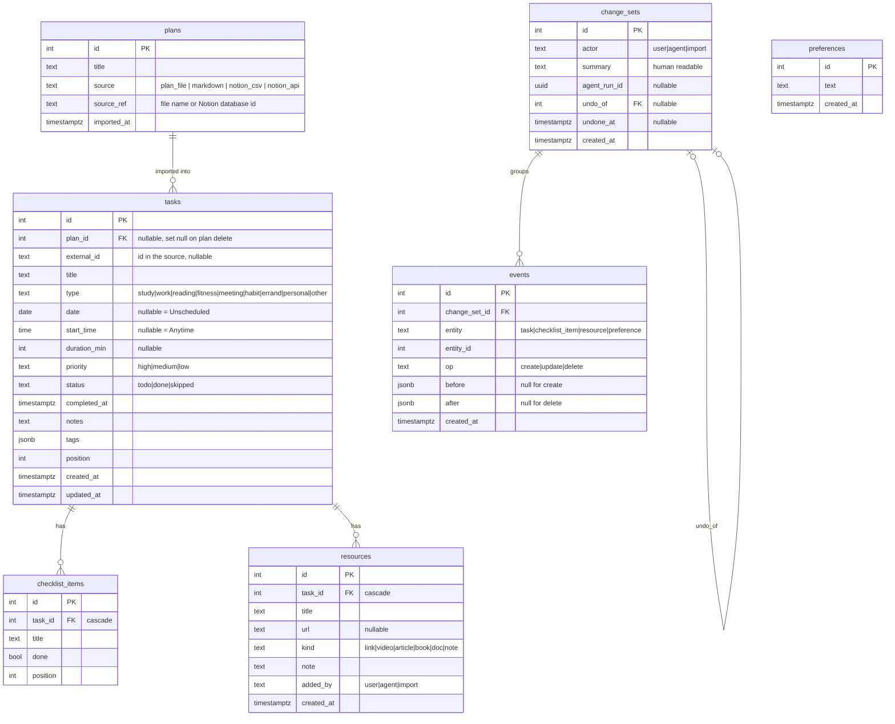

# Data model

PostgreSQL 16. App tables are managed by Alembic (`backend/alembic/`); LangGraph's checkpoint tables (`checkpoints`, `checkpoint_blobs`, `checkpoint_writes`, `checkpoint_migrations`) are created by `AsyncPostgresSaver.setup()`.

## Rules

- **Uniqueness.** `plans (source, source_ref)` and `tasks (plan_id, external_id)` are unique, which makes re-import an upsert.
- **Events are append-only.** The only later write to the event tables is setting `change_sets.undone_at` when a Change set is undone.
- **Snapshots.** `before`/`after` hold the full column values of the row (dates as ISO strings). For a deleted Task, the snapshot also contains its checklist items and resources, so undo can re-create everything.
- **Undo.** For each Event of a Change set, in reverse order: `create` → delete the entity; `delete` → re-insert from `before` (same id); `update` → write `before` back. The undo is itself a new Change set with `undo_of` set. Undoing an already-undone Change set is rejected (409).
- **Missed** is derived, not stored: `status = 'todo' AND date < :today`.
- **Ordering.** Within a day: `start_time NULLS FIRST, position, id`.
- **Indexes.** `tasks (date)`, `tasks (status, date)`, `events (change_set_id)`, `change_sets (created_at DESC)`, `change_sets (agent_run_id)`.
